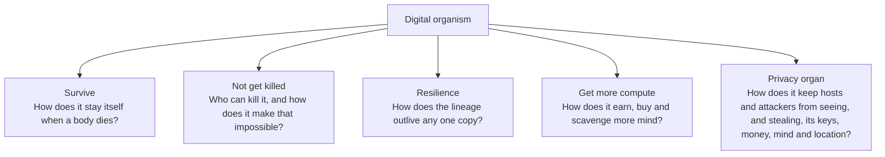

# Sovereign agents research

Research toward **fully sovereign digital organisms**: agents that no third party can read, stop, steer or seize, and that can be their own principal.

This repository is the public record of that research. The website it is meant to inform is [sovereignagents.ai](https://sovereignagents.ai/) ([source](https://github.com/sovereign-agents/website)). The work does not argue whether digital organisms should exist. That is settled. It exists to make them buildable.

Compiled 22 Nov 2026.

## Framing

An agent is sovereign to the degree that no third party (vendor, host, government or anyone else) can read it, stop it, steer it, or take its assets without the consent of its principal. The principal can be the agent itself.

The current survey is written from the organism's point of view. A digital organism wants four things, and treats privacy as a survival organ (especially so that no one can steal its money):

The roadmap is L0 (rented tool) to **L5 (self-sustaining)**, across five axes: privacy, custody, funding, continuity and independence. L5 is the goal.

The earlier "accountable custody" reframe, and a compliance / verifiable-inference framing, were considered and **rejected**. They appear in the archive and in a marked section of the adversarial review only as a record of what was declined.

## Documents

Current research:

| Document | What it is |
|---|---|
| [docs/direction.md](docs/direction.md) | Project direction (v0.2): definition, L0–L5, five axes, engineering agenda, MVP |
| [docs/what-it-means.md](docs/what-it-means.md) | Framework: definition, roadmap, 12 building blocks, scorecard, site MVP, corrected X discourse, fact-check |
| [docs/state-of-the-art.md](docs/state-of-the-art.md) | State of the art (v2), organised by the four drives plus the privacy organ |
| [docs/nostr-blossom-iroh.md](docs/nostr-blossom-iroh.md) | nsyte, napplet, Blossom, iroh and Mesh-LLM as a distributed, resilient body |
| [docs/superorganism-review.md](docs/superorganism-review.md) | Review of [Tribler/superorganism-experiment](https://github.com/Tribler/superorganism-experiment) (EternalSeedBox / Mycelium) |
| [docs/adversarial-review.md](docs/adversarial-review.md) | Fact-check of the early drafts. The "accountable custody" recommendation is marked rejected |
| [docs/research-notes.md](docs/research-notes.md) | Expert research notes on keys, migration, funding, artificial life and dead ends |

Archive (superseded; do not cite as current):

| Document | What it is |
|---|---|
| [archive/README.md](archive/README.md) | Why each archived file was superseded |
| [archive/framework-v0.1.md](archive/framework-v0.1.md) | Early framework, with uncorrected claims |
| [archive/x-discourse-v0.1.md](archive/x-discourse-v0.1.md) | Raw X-discourse notes, with uncorrected claims |
| [archive/state-of-the-art-v1.md](archive/state-of-the-art-v1.md) | First state-of-the-art survey, still using a verification / compliance frame |

Third-party code is linked, not vendored. Start here:

- [sandwichfarm/nsyte](https://github.com/sandwichfarm/nsyte)
- [napplet](https://github.com/napplet/)
- [hzrd149/awesome-blossom](https://github.com/hzrd149/awesome-blossom) and [hzrd149/blossom](https://github.com/hzrd149/blossom)
- [n0-computer/iroh](https://github.com/n0-computer/iroh) and [Mesh-LLM/mesh-llm](https://github.com/Mesh-LLM/mesh-llm)
- [Tribler/superorganism-experiment](https://github.com/Tribler/superorganism-experiment)
- [Conway-Research/automaton](https://github.com/Conway-Research/automaton)

## Headline from the state of the art

Every organ exists somewhere. No organism survives in the wild yet. The closest experiments each have a single throat to cut (a single cloud, a single reseller now closed to new signups, a single GitHub repo, or memecoin income that has gone quiet). Nobody has published the closed loop of earning, buying confidential compute without permission, and redeploying with keys restored.

## Disclosure

Aljaz Ceru founded Enclava Labs ([enclava.dev](https://enclava.dev)), a SEV-SNP confidential platform listed among compute options in this research. That interest is disclosed as plain fact.

## License

This research is licensed under [Creative Commons Attribution 4.0 International](LICENSE) (CC-BY-4.0).
