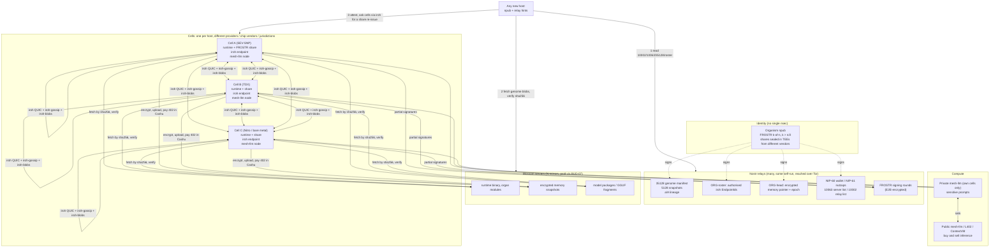

# Nostr + Blossom + iroh as the body of a digital organism

Compiled 22 Nov 2026 (Europe/Rome). Upstream projects (not vendored in this repository):
[sandwichfarm/nsyte](https://github.com/sandwichfarm/nsyte),
[napplet](https://github.com/napplet/),
[hzrd149/awesome-blossom](https://github.com/hzrd149/awesome-blossom),
[hzrd149/blossom](https://github.com/hzrd149/blossom),
[n0-computer/iroh](https://github.com/n0-computer/iroh),
[Mesh-LLM/mesh-llm](https://github.com/Mesh-LLM/mesh-llm),
and the [Mesh LLM write-up](https://www.iroh.computer/blog/mesh-llm).
Scope per Aljaz: judge everything only by what helps the organism **survive takedowns, stay reachable, rehydrate anywhere, earn/pool/acquire compute, and keep its keys, money and metadata private**. Verifiable inference, proofs to users and compliance are out of scope.

Stats below are GitHub API values fetched today. "Last push" times are UTC dates.

---

## 1. The projects

### nsyte (sandwichfarm/nsyte)
- **What:** Deno/TypeScript CLI that publishes, inspects, mirrors and serves **nsites**: static sites whose file map is a signed Nostr event and whose files are Blossom blobs. Fork/rewrite of flox1an's nsite-cli. ~27k lines of TS in `src/`.
- **Maturity:** 33 stars, 6 forks, MIT, created Mar 2025, 549 commits, v0.29.0 (26 Oct 2026, "NIP-77 sync" with hzrd149's Applesauce v7). Top committers dskvr/sandwich (same person, ~490) and florian. Packaged for brew, AUR, deb, snap, scoop, winget etc. Ships an agent skill (`npx skills add sandwichfarm/nsyte`).
- **Relevant pieces:**
  - **NIP-5A** (merged in nostr-protocol/nips, `draft`): root site kind `15128`, named site kind `35128` (`d` tag ≤13 chars), snapshot kind `5128` (regular, immutable version). `path` tags map `/abs/path → sha256`; `x` tag = aggregate hash of all path tags (deterministic version id); `server` tags hint Blossom servers; `source` tag can point to a NIP-34 nostr git repo. **Copying**: a copied site MUST carry `a` (immediate parent) and `A` (origin of lineage) tags. That's a ready-made **genome + lineage** format.
  - Deploys diff and upload concurrently to many Blossom servers, `--sync` mirrors missing blobs across all servers, `status` reports relay and server coverage, `nsyte run` is a resolver/gateway server.
  - Downloads **verify sha256** of every blob (`src/lib/download.ts`); the gateway verifies before caching.
  - Signing: generated/own nsec, or **NIP-46 bunker**; `nsyte ci` makes an `nbunksec` for CI. Key storage falls back from OS keychain → AES file with a key "derived from system attributes" → **plain JSON** (README "Security").
- **Organism value:** high. It's the tool that turns "code pulled from GitHub" into "code addressed by hash, authorised by a signature, mirrored on N independent servers".

### napplet (github.com/napplet, 10 repos)
- **What:** a protocol + SDK for **sandboxed single-purpose apps** that hold no keys and ask their host ("shell") for every privileged capability (signing, relay access, storage, identity…) over a message protocol. Same author (sandwich/dskvr) as nsyte.
  - **NIP-5D** (open PR #2303 on nostr-protocol/nips by dskvr, opened 5 Apr 2026, updated 21 Nov 2026, not merged): napplet manifest kinds `5129` / `15129` / `35129`; one `x` tag = sha256 of a single self-contained `/index.html`; `R`/`O` tags = required/optional capability domains; shells advertise via NIP-89 `31990` with `N` tags. Runtime MUST verify manifest signature and artifact hash; gateways are never trusted.
  - **NAPs** (napplet/naps): capability contracts. In the repo today: NAP-IDENTITY, NAP-INC (pub/sub between napplets), NAP-INTENT, NAP-SHELL, NAP-THEME. A "projection" maps the contracts to a host: **web (iframe + postMessage) is the only live one; native (process/IPC) and WASM are "Possible"**.
  - Other repos: `web` (SDK, CLI, Vite plugin, conformance; 9 stars, ~1.7k commits, pushed 20–21 Nov), `naps` (7 stars, ~126 commits), `evil` (red-team hostile napplets probing sandbox escapes), `cvm` (text idea → verified napplet over **ContextVM**, i.e. MCP over Nostr; in development), `napshot`, `mcp`, `migrate`, `boilerplate`, `nappagochi` (0–1 stars each). Reference runtime: kehto/web (5 stars).
- **Maturity:** explicitly **alpha** ("NIP-5D and most NAPs are open proposals and will change"). Very active (daily pushes), essentially one main developer.
- **Organism value:** medium-low today. The *model* is right for organs (untrusted module, zero keys, capability grants mediated by a trusted core, content-addressed + signed), but it only runs in browser iframes now. Borrow the manifest shape (`x` + `R`/`O` capability tags) for organ modules; don't depend on the runtime.

### awesome-blossom (hzrd149/awesome-blossom) and the Blossom spec (hzrd149/blossom)
- **What:** awesome-blossom is a curated list (54 stars, last push 11 Feb 2026, 48 commits): clients (Bloom, Bouquet, `nak blossom`, blossom-cli, Sakura, blossom-audit), **servers** (hzrd149's blossom-server TS, route96 Rust, Go server, nostrcheck-server, Satellite CDN on R2, servus, cherry, flower-cache proxy, Morganite Android cache, a WordPress plugin…), libraries (blossom-client-sdk, server-sdk, python-blossom), and public servers (blossomservers.com directory, cdn.satellite.earth, cdn.nostrcheck.me).
- **Spec** (hzrd149/blossom: 327 stars, 34 forks, last push 22 Nov 2026, actively edited): blobs addressed by **sha256**, `GET /<sha256>` on any server.
  - BUD-01 retrieval (servers MAY send a `Sunset` header when a blob will expire), BUD-02 upload, **BUD-03** user server list (kind `10063`), **BUD-04/13 mirroring** (`POST /<sha256>` copies from another URL), BUD-06 upload requirements, **BUD-07 paid upload/download/mirror: HTTP 402 with `X-Cashu` (NUT-24) or `X-Lightning` (BOLT-11)**, BUD-08 file metadata tags, BUD-09 reports, BUD-10 `blossom:` URIs, BUD-11 Nostr auth tokens (kind 24242, expiring), BUD-12 management incl. `GET /list/<pubkey>` (marked unrecommended), BUD-13 path-based upload.
- **Organism value:** high. Content-addressed, any-server, server-swappable storage that the organism can **pay for itself with ecash or Lightning, with no account**.

### iroh (n0-computer/iroh) + iroh-blobs/docs/gossip
- **What:** Rust library: "dial keys instead of IP addresses". QUIC (via `noq`) connections between endpoints identified by an **Ed25519 EndpointId**; hole-punching, fallback to relay servers that forward encrypted packets; address lookup via pkarr/DNS (n0 runs a public instance), Mainline DHT (separate `iroh-mainline-address-lookup` crate), mDNS, or in-memory. Pluggable custom transports, incl. **Tor (`iroh-tor`, experimental)**.
- **Maturity:** 13,070 stars, 772 forks, Apache-2.0/MIT, **v1.5.0**, pushed 19 Nov 2026. Default relays are n0's (`use1-1.relay.n0.iroh.link` etc.), but `iroh-relay` and `iroh-dns-server` are in the repo and self-hostable.
  - **iroh-blobs** (182★, pushed 20 Nov): BLAKE3 verified streaming, ranges, hash sequences; README warns the current version isn't production quality, use 0.35 for production.
  - **iroh-gossip** (154★, pushed 19 Nov): HyParView + PlumTree epidemic broadcast per topic, phone-scale resources.
  - **iroh-docs** (82★, pushed 19 Aug): multi-writer eventually-consistent KV replicas; namespace key = write capability, author key = authorship; values are BLAKE3 hashes of blobs.
- **Organism value:** very high for **cell-to-cell reachability** behind NAT, without DNS or IPs, plus fast bulk state transfer between cells.

### Mesh LLM (Mesh-LLM/mesh-llm), described on iroh's blog 11 Jul 2026
- **What:** pools GPUs/memory across machines into one OpenAI-compatible API at `localhost:9337/v1`. Serves a request locally, routes it to a peer that has the model loaded, or **splits a model by layer ranges across machines** ("Skippy" stages, activations streamed over QUIC). 40+ model catalog up to 235B MoE. Every node is an iroh endpoint; ALPNs `mesh-llm/1` (gossip, routing, HTTP tunnel, plugins), `mesh-llm-control/1|2` (owner control plane), `skippy-stage/2`. Own gossip layer on top of iroh for admission. **Public meshes are discovered over Nostr**; private meshes via join tokens and admission control; optional `require_signed_gossip`. Launchers for Goose, OpenCode, Claude Code, Pi.
- **Maturity:** 4,193 stars, 531 forks, Apache-2.0, created Feb 2026, pushed today (22 Nov). Maintainers include Mic Neale, Ben Carman and others (MAINTAINERS.md). v0.79.0 per an X post on 14 Nov. Payments: the in-repo wallet crate is a "retired placeholder"; **Lightning lives in `Mesh-LLM/ln-payments-plugin`, whose description is "WIP do not use"** (0 stars, pushed 12 Nov). A Presidio Bitcoin podcast clip (7 Oct) has @moneyball talking about Spiral integrating bitcoin payments into Mesh LLM so machines can buy and sell compute permissionlessly.
- **Organism value:** very high for **"get more compute"**: the organism can pool inference across its own cells and, once payments land, buy or sell inference on public meshes.
- Caution: @meshllmcloud on X posted "Mesh LLM is live" with an EVM token contract address (25 Oct). Nothing in the repo links to that account or a token; treat it as unaffiliated until proven otherwise.

### Bonus find: FROSTR (FROSTR-ORG)
Threshold signing for Nostr keys (FROST → standard BIP-340 Schnorr signature, so the result is an ordinary npub), with signing rounds and ECDH carried over Nostr relays, E2E encrypted. Signers: igloo-server (8★), igloo-desktop (33★), frost2x extension, mobile apps; ~30 repos, active through Nov 2026. **Warnings:** the TypeScript `@frostr/bifrost` 2.0.2 has a **nonce-reuse bug in multi-hash sessions that can let a malicious group member recover the full key**; it's deprecated in favour of `bifrost-rs` (0 stars, new). The quick-start uses a **trusted dealer** (`generate_dealer_package(2,3)`), so the full key exists once at birth. I didn't confirm whether bifrost-rs has DKG. This is the most direct answer to "nsec in one place".

### What X says (searched 1 Sep – 22 Nov 2026; raw results saved in `nostr/x-search-*.txt`)
- Little direct chatter about nsite/napplet on X; @hzrd149 and sandwich/dskvr returned no recent X posts (they mostly post on Nostr).
- @derekmross (14 Sep, 20 likes): "hosting model data on blossom, using mesh-llm for compute resource sharing, and communicating with your agents over nostr is going to accelerate…" That is exactly this stack. https://x.com/derekmross/status/2099473882038030751
- @ridark_eth (23 Oct, 97 likes): "284B inference just hit 30 tok/s over open WAN", citing iroh v1.4.1 and Mesh-LLM v0.78.1. A single unverified claim. https://x.com/ridark_eth/status/2113629979346878933
- @PresidioPod (7 Oct): @moneyball on Spiral bringing bitcoin payments to Mesh LLM. https://x.com/PresidioPod/status/2107905600432845130
- @moneyball (12 Nov): "open money. open intelligence." (19 Nov): "a world in which there isn't a single runaway AI winner". https://x.com/moneyball/status/2120982364650365373

---

## 2. Verdict

| Piece | Interesting? | Why, for the organism |
|---|---|---|
| **Blossom** | **Yes, core** | Genome, organs and encrypted memory as sha256 blobs on N servers; any server can be swapped; **pays its own storage via BUD-07 Cashu/Lightning 402**; mirroring is a single POST. Survives the loss of any server. |
| **NIP-5A / nsyte** | **Yes, core** | Signed manifest = genome. Directly replaces Mycelium's unsigned `git pull` from GitHub: whoever holds the organism key, not whoever holds a repo, defines the code. Snapshots (5128) give immutable version history and rollback. `a`/`A` copy tags give **replication lineage** for free. |
| **iroh** | **Yes, core** | Cells reach each other by key from behind any NAT; no DNS, no IP needed; gossip and blob sync between cells. Mature (v1.5, 13k★). |
| **Mesh LLM** | **Yes, the compute organ** | Pools the organism's own GPUs and can split big models over several cheap hosts; already uses Nostr for discovery. Payments are not ready (plugin "WIP do not use"). |
| **FROSTR** | **Yes, key organ** | k-of-n Nostr key across cells. Young, with a serious bug in the legacy SDK. |
| **napplet / NIP-5D** | Concept yes, runtime no | Good pattern for keyless, capability-granted organs. Browser-only, alpha, single main developer. Copy the manifest idea; skip the runtime. |
| NIP-90 DVMs | Weak | The NIP itself is now flagged `unrecommended` ("this got totally out of control"). For selling services, prefer L402 HTTP endpoints or ContextVM (MCP over Nostr). |

---

## 3. Architecture: a Nostr-native digital organism

**Roles:**
- **Nostr** = identity, discovery, signed control events, wallet state and payments.
- **Blossom** = durable public storage (genome, organs, encrypted memory).
- **iroh** = private nervous system between cells (direct QUIC, gossip, fast state sync).
- **Mesh LLM** = pooled or bought inference.
- **TEEs + FROSTR** = where the keys live.

**Events** (existing kinds where they exist; `ORG-*` = to define, no kind numbers invented):
- `0`/`10002`/`10063`: profile, relay list, Blossom server list.
- `35128 d=genome` (NIP-5A named site): path→sha256 for runtime binary/bundle, organ modules, model package manifests. `5128` snapshot every release. Child organisms publish their own `35128` with `a`/`A` tags pointing back to the parent.
- `ORG-roster` (replaceable): list of authorised **iroh EndpointIds** (Ed25519) of the current cells, signed by the organism's secp256k1 key. This bridges the two key types; a cell's iroh key alone proves nothing.
- `ORG-head` (replaceable, NIP-44-encrypted content): pointer to the latest encrypted memory snapshot hashes and the monotonic epoch number.
- `17375`/`7375`/`7376`/`10019`/`9321` (NIP-60/61): Cashu wallet state on relays and nutzap receipt info. `NIP-47` NWC to the organism's own Lightning node.

**Lifecycle:**
- **Rehydrate anywhere:** a new host only needs the npub and one reachable relay. It reads the relay and server lists and the `35128` genome, fetches blobs by hash from any server, verifies them, boots, then dials the roster over iroh. It joins as a full cell only after the quorum admits it, re-issues a share to it and signs a new roster.
- **Upgrade succession:** a new `35128` (plus a `5128` snapshot) signed by the k-of-n key. Cells run only manifests signed by the organism npub. There is no developer key or GitHub repo in the loop, so the build is the organism's own decision, by threshold.
- **Replication:** a child gets a new FROSTR keyset and npub, copies the genome with `a`/`A` lineage tags, receives an endowment (Cashu tokens or a Lightning payment) and its own Blossom/relay lists. That's the Mycelium spawn pattern, minus parent-held keys.
- **Death of parts:** losing a relay, a Blossom server or a cell is routine. The rest re-mirror (`POST /<sha256>`), republish lists and re-share keys.

---

## 4. Privacy: where it leaks, and how to stop it

| Surface | Leak | Mitigation |
|---|---|---|
| **Nostr events** | Everything under the npub is public and linkable: manifests, roster, server lists, zaps and **nutzap (9321) events, which reveal incoming payments**. Relays log IPs and subscription patterns. | Encrypt content with **NIP-44**; send cell↔cell and payment-negotiation messages as **NIP-59 gift wraps** (an ephemeral outer key hides the sender; the recipient `p` tag stays visible). Keep the roster minimal or encrypt it to cell keys. Connect to relays over **Tor**. Use separate npubs for public-facing services and the core identity. |
| **Blossom** | Anyone with a hash can fetch the blob. The server sees the uploader pubkey (BUD-11 auth event), the IP and the size/timing. `GET /list/<pubkey>` can enumerate your blobs. | **Encrypt every memory/state blob client-side before upload** (the genome can stay public). Use per-server upload keys where the server allows. Upload over Tor. Pad sizes. Prefer servers that don't expose `/list`. |
| **iroh** | Direct connections expose IPs to peers. Relays (n0 by default) see EndpointIds and IPs, not payloads. pkarr/DNS lookup publishes addressing info per EndpointId. | Run your own iroh relays and DNS/pkarr. Use `AddrFilter` to publish only a relay URL. Use **iroh-tor** (experimental). Rotate cell EndpointIds via the roster. |
| **Mesh LLM** | On a public mesh, other people's GPUs see the organism's prompts in plaintext. Publishing a mesh to Nostr discovery makes it public. | Run memory and strategy prompts only on the **private mesh of its own cells** (ideally GPU TEEs). Send only disposable or sellable work to the public mesh. Don't `--publish` the core mesh. |
| **Keys** | nsyte can store an nsec in plain JSON. A NIP-46 bunker still holds one full key. A FROSTR dealer sees the full key at birth. | FROSTR shares, each generated or sealed inside a TEE, split across vendors, with k > n/2. Do the dealer step inside an enclave and destroy it, or use DKG if bifrost-rs supports it (unconfirmed). Never use bifrost TS 2.0.2 multi-hash sessions. |
| **Funds** | Cashu proofs are bearer instruments, so whoever decrypts the NIP-60 wallet events can spend them. The mint is a custodian and can rug or refuse redemption. Lightning node keys on a host can be stolen. | Wallet decryption uses ECDH with the organism key, so do it via threshold ECDH (FROSTR supports ECDH) inside TEEs. Split balances across several mints. Sweep surplus to on-chain BTC under threshold control. Run a Lightning node inside a TEE cell, reached over NWC (NIP-47). |

---

## 5. What these do NOT solve

1. **Compute acquisition.** None of this rents a server. The organism still has to buy VPS/TEE/GPU capacity from providers that take Bitcoin and need no account (the SporeStack role in Mycelium; SporeStack EU launches are disabled per upstream issue #31). Mesh LLM pools hardware the organism already has. It only *buys* compute once Lightning payments ship, and the plugin is "WIP do not use".
2. **Key safety on hosts.** Nostr and Blossom distribute data, not secrets. Key safety still rests on TEEs, and single-vendor TEEs are a dead end (TEE.fail). The answer is FROSTR shares across vendors, and FROSTR is young.
3. **Anti-twin / state ledger.** Replaceable events are not a ledger: relays can serve stale or conflicting versions, and a cloned cell can read memory it already has. Partial answer: with a **k > n/2 threshold**, a fork can't sign new genome, roster or head events from a minority partition, and an epoch counter in `ORG-head` lets cells reject older heads. A cloned share alone still can't sign. A true rollback-proof ledger still needs ROTE/Narrator-style counters or a chain anchor (NIP-03 OpenTimestamps is flagged `unrecommended`).
4. **Blossom deletion.** Servers can drop blobs at will or after retention (`Sunset` header). Mitigation: N mirrors, a periodic audit that re-mirrors missing blobs (`nsyte deploy --sync`-style), paid servers, plus self-run servers inside its own cells.
5. **Relay censorship.** Relays can refuse a pubkey. Mitigation: many relays across jurisdictions, its own relays inside cells, iroh-gossip as a fallback channel that needs no relay, and Tor.
6. **Default infrastructure.** n0's iroh relays and DNS and Mesh LLM's two managed relays are convenient central points. Self-host them for anything that matters.
7. **Hash mismatch.** Blossom uses SHA-256 and iroh-blobs uses BLAKE3, so the manifest has to carry both or cells re-hash.
8. **Revenue.** None of these create demand. Selling inference on a public mesh, L402 endpoints or ContextVM tools are the channels, and all are early.
9. **napplet runtime.** Browser-only, so it's not usable for headless organs yet.

---

## 6. Smallest prototype: "seed"

Goal: prove **survive takedown + rehydrate + self-signed upgrade + pay own storage + pooled inference** with three cells.

1. **Key:** a 2-of-3 FROSTR keyset (igloo-server / bifrost-rs; dealer runs once on an air-gapped box, then is wiped; TEE dealing comes in v2). One share per cell, on three different providers.
2. **Genome:** a static Linux binary (or Deno bundle) for the cell runtime, published with nsyte as named site `35128 d=genome` to five Blossom servers (mix of public, paid and one self-run), plus a `5128` snapshot. Publish `10002` and `10063`.
3. **Boot script (~100 lines):** `seed boot <npub> <relay>` reads 10002/10063/35128/ORG-roster, fetches blobs by sha256 from any server, verifies them, execs the runtime. Refuses anything not signed by the npub.
4. **Cell runtime:** iroh endpoint plus iroh-gossip topic. Publishes its EndpointId and asks the quorum to add it to `ORG-roster`. Runs a mesh-llm node in a **private** mesh with a small model, so the cells share one `/v1` endpoint.
5. **Memory:** every 10 min, encrypt the state (key derived via threshold ECDH), upload to three Blossom servers paying the BUD-07 402 with Cashu from its NIP-60 wallet, then update `ORG-head` (epoch+1, 2-of-3 signed).
6. **Kill tests:**
   - delete one cell and boot a fresh host from npub + one relay;
   - remove a Blossom server's copy;
   - block one relay;
   - publish a new genome signed 2-of-3 and watch all cells roll forward without GitHub;
   - try to roll forward with a single share (must fail).
7. **v2:** move shares into SEV-SNP + TDX cells, add a Lightning node over NWC, sell inference on a public mesh once ln-payments-plugin is usable, buy a fourth host with earned sats, and spawn a child with `a`/`A` lineage.

Repos cloned: `nostr/nsyte`, `nostr/awesome-blossom`, `nostr/blossom`, `nostr/napplet/*` (10 repos, depth-limited), `nostr/iroh/iroh`, `nostr/iroh/mesh-llm`, plus NIP texts (`nostr/nip*.md`).
