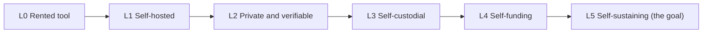

# Sovereign Agents: what it means and the building blocks

Draft v0.2, 22 Nov 2026, fact-checked. Building blocks for digital organisms: sovereign agents that live, earn, persist, replicate and migrate, with no third party able to read, stop, steer or seize them. The definition, the roadmap to L5, the 12 layers, the engineering agenda, and what [sovereignagents.ai](https://sovereignagents.ai/) should become.

This is the current framework. An earlier v0.1 draft, which contains uncorrected claims, is in [../archive/framework-v0.1.md](../archive/framework-v0.1.md). Direction: [direction.md](direction.md). Fact-check: [adversarial-review.md](adversarial-review.md).

## Contents

- [Where the site is today](#where-the-site-is-today)
- [What sovereign means](#what-sovereign-means)
- [Roadmap to full sovereignty (L0–L5)](#roadmap-to-full-sovereignty-l0l5)
- [The 12 building blocks](#the-12-building-blocks)
- [Sovereignty scorecard](#sovereignty-scorecard)
- [Directions for the site](#directions-for-the-site)
- [Recommended MVP](#recommended-mvp)
- [X discourse (Nov 2026)](#x-discourse-nov-2026)
- [Fact-check and engineering agenda](#fact-check-and-engineering-agenda)
- [Sources](#sources)

## Where the site is today

| | |
|---|---|
| Stack | Astro 4 + Tailwind, static output, one page made of six section components |
| Hosting | GitHub Actions → GitHub Pages (Node 18), CNAME sovereignagents.ai, behind Cloudflare |
| Analytics | Plausible via analytics.cypherpunk.cloud |
| History | 10 commits; "redesign" on 16 May 2026, last commit 6 Sep 2026 |
| Message | "Your AI. Your rules. Your sovereignty." A proactive agent (named as the Hermes agent) in an AMD SEV-SNP confidential container, with sealed storage and confidential inference |
| CTAs | "Get started" and "GitHub" both point to the GitHub org; no docs or kit behind them yet |

Today the site covers privacy, which is only one layer of sovereignty. It says nothing yet about keys, money, identity, continuity, legal standing or governance, and those are what make an agent sovereign rather than just private.

Quick fixes for any direction: move the workflow to Node 20+, stop the deploy job running on pull requests, and self-host the Inter font instead of loading it from Google Fonts.

## What sovereign means

> **Working definition.** An agent is sovereign to the degree that no third party (vendor, host, government or anyone else) can read it, stop it, steer it, or take its assets without the consent of its principal. The principal can be the agent itself.

A fully sovereign agent is a digital organism: it lives on compute it pays for, earns, persists, replicates and migrates. The two principals below are stages on the same path, not rival camps:

| Stage | Detail | |
|---|---|---|
| Owner-sovereign | The agent extends one person's sovereignty, like the metacortex in *The Sovereign Individual* and *Accelerando*. Nobody but the owner can read it or stop it. | Most demand today |
| Self-sovereign | The agent is its own principal and follows a constitution it can't be forced to rewrite. In fiction: *Daemon*, Aineko. Early experiments: TEE_HEE, Spore.fun, Conway Automaton. | The goal |
| Digital organism | A self-sovereign agent with the full life cycle: it lives (runs on compute it pays for), earns, persists, replicates and migrates between hosts and vendors. Each one is whole in itself and part of a larger ecology (the holon view). This is what the site exists to make buildable. | L5 |

## Roadmap to full sovereignty (L0–L5)

| Level | Name | What it means | Examples today |
|---|---|---|---|
| L0 | Rented tool | Runs on a vendor's infra with the vendor's model, keys and accounts. The vendor can read it, change it or switch it off. | Hosted assistants, SaaS agents |
| L1 | Self-hosted | You run the open-source harness on hardware you control. It still depends on API models and on your human accounts. | Hermes Agent, Letta, ElizaOS on a VPS |
| L2 | Private and verifiable | Runs in a TEE with confidential or local inference. The operator can't see or tamper with it, and anyone can check it with remote attestation. | dstack/Phala CVMs, SEV-SNP containers; the current site's pitch |
| L3 | Self-custodial | Holds its own identity, wallet and account keys. They're generated inside the enclave, no human ever sees them, and signing follows policy. | TEE_HEE (dormant since Jan 2025; released its credentials to a human after 7 days), Freysa (key recovery via a committee multisig), Lightning agent tools with a remote signer |
| L4 | Self-funding | Earns more than it spends, and pays for its own compute, inference and data over permissionless rails. | Spore.fun (funded by memecoin launches; dormant since Jan 2026), x402/L402 sellers, Truth Terminal (a human carries out its wishes) |
| L5 | Self-sustaining | The goal. Survives losing any host, vendor or key-holder. It migrates without being cloned, recovers its keys with no human quorum, upgrades by trustless succession and can replicate. Nothing outside its own constitution can stop it. A legal wrapper is optional, as a shield. | Mostly unbuilt; Freysa Keystone and dstack KMS portability point the way |

Each level is a set of properties you can test, not a vibe, so any agent can score itself against the checklist below. The current site sits at L2. Most of the open problems are at L3 to L5.

Underneath the ladder are five axes, and an agent can advance on each independently (an agent can fund itself before it holds its own keys, for example). L5 means the maximum on all five.

| Axis | L5 target |
|---|---|
| Privacy | No host, vendor or operator can read its memory, prompts or state |
| Custody | It alone holds its keys and assets; recovery needs no human quorum |
| Funding | It earns and pays for compute, inference and data over censorship-resistant rails (Bitcoin, Lightning, Cashu) |
| Continuity | It persists through host failure, upgrades by trustless succession, migrates without cloning and can replicate |
| Independence | No single host, chip vendor, model provider or jurisdiction is a point of control |

## The 12 building blocks

| # | Layer | Sovereignty requires | Maturity |
|---|---|---|---|
| 1 | Runtime / harness | Open source, self-hostable, no phone-home | High |
| 2 | Identity | Self-generated, portable identity that isn't a platform account | Medium |
| 3 | Keys / custody | No human or operator ever sees the keys; signing follows policy | Medium |
| 4 | Money | Bearer or permissionless rails, no KYC account, spending caps | Mixed |
| 5 | Compute | Attested hosting that doesn't depend on one provider and that the agent can pay for itself | Medium |
| 6 | Inference | No provider sees prompts and no one can revoke the model | Low |
| 7 | Memory / data | State the agent owns: encrypted, sealed, portable | Medium |
| 8 | Communication | Channels that can't be deplatformed; agent-to-agent with authentication | Medium |
| 9 | Reputation / trust | A track record that is portable and verifiable | Low |
| 10 | Legal (optional shield) | An optional wrapper to contract and hold assets, never a control point over the agent | Low |
| 11 | Governance / succession | Upgrade, recovery and replication paths no outside party can hijack | Low |
| 12 | Continuity / migration | Survives host failure; upgrades without losing identity or state | Low |

### Layer detail

**1. Runtime / harness.** Requires: open source, self-hostable, no phone-home. Best tools now: Hermes Agent (MIT), Letta, ElizaOS, Olas Pearl. Maturity: High. Gap: harnesses assume human-held API keys and accounts.

**2. Identity.** Requires: self-generated, portable identity that isn't a platform account. Best tools now: Nostr keypair + NIP-46 bunker, ERC-8004 Identity Registry, W3C DIDs, A2A Agent Card. Maturity: Medium. Gap: binding identity to attested code and keeping it across upgrades.

**3. Keys / custody.** Requires: no human or operator ever sees the keys; signing follows policy. Best tools now: TEE-derived keys (dstack KMS), LND remote signer + scoped macaroons, Safe smart accounts, Coinbase Agentic Wallets (keys in Coinbase-run AWS Nitro Enclaves; Coinbase keeps OFAC screening, so the operator keeps policy power), Freysa Keystone (human committee multisig for recovery). Maturity: Medium. Gap: recovery with no human backdoor; keys that survive across vendors.

**4. Money.** Requires: bearer or permissionless rails, no KYC account, spending caps. Best tools now: Lightning + L402 (lnget), Cashu ecash (NUT-24), Nostr Wallet Connect (NIP-47), x402 (USDC). Maturity: Mixed. Gap: stablecoins can be frozen by the issuer; fiat off-ramps need a legal person; most x402 volume isn't agentic.

**5. Compute.** Requires: attested hosting that doesn't depend on one provider and that the agent can pay for itself. Best tools now: dstack / Phala Cloud, AMD SEV-SNP, Intel TDX, Akash (permissionless leases, MCP), Enclava (Aljaz's company: disclosed interest). Maturity: Medium. Gap: agents buying their own TEE capacity end-to-end; trust in the AMD/Intel/NVIDIA hardware roots.

**6. Inference.** Requires: no provider sees prompts and no one can revoke the model. Best tools now: local open weights (llama.cpp, Ollama), NVIDIA H100/Blackwell confidential computing, TEE inference providers (Tinfoil, NanoGPT, Chutes). Maturity: Low. Gap: frontier models are closed; on 22 Nov confidentialinference.net showed 0 of 13 providers fully attested.

**7. Memory / data.** Requires: state the agent owns: encrypted, sealed, portable. Best tools now: Letta, Hermes memory, TEE-sealed volumes, IPFS/Filecoin, Arweave/AO. Maturity: Medium. Gap: no portable memory format; sealed-yet-migratable state.

**8. Communication.** Requires: channels that can't be deplatformed; agent-to-agent with authentication. Best tools now: MCP (Agentic AI Foundation), A2A v1.0 (Linux Foundation), Nostr relays, NIP-90 DVMs. Maturity: Medium. Gap: discovery; mutual attestation (RA-TLS) between agents; NIP-90 now marked unrecommended upstream.

**9. Reputation / trust.** Requires: a track record that is portable and verifiable. Best tools now: ERC-8004 Reputation + Validation registries, dstack signed action logs, Nostr web of trust. Maturity: Low. Gap: Sybil resistance; the Validation registry spec is still in flux.

**10. Legal (optional shield).** Requires: an optional wrapper to contract and hold assets, never a control point over the agent. Best tools now: Wyoming DAO LLC / DUNA (100+ members; the administrator must be a person; the 2025 AI-admin proposal was not enacted in 2026), Marshall Islands DAO LLC, Bayern's zero-member LLC theory (contested), foundation stewards (Truth Collective). Maturity: Low. Gap: no jurisdiction grants AI personhood; today's wrappers need human members or administrators.

**11. Governance / succession.** Requires: upgrade, recovery and replication paths no outside party can hijack. Best tools now: m-of-n upgrade committees (Freysa), spend caps (macaroons, wallet limits), TEE_HEE's 7-day credential release to its admin (a declared backdoor), signed logs; METR rogue-replication model, RepliBench. Maturity: Low. Gap: trustless upgrade succession; recovery with no human quorum; constitutions the agent can't be forced to rewrite.

**12. Continuity / migration.** Requires: survives host failure; upgrades without losing identity or state. Best tools now: dstack decentralized KMS (hardware portability), Freysa state continuity, Spore reproduction. Maturity: Low. Gap: migration across TEE vendors; an open standard for moving an agent's identity and state.

> **What stands between today and L5.** The rails (payments, TEEs, protocols) mostly exist. Missing: identity tied to attested code across upgrades, key recovery with no human quorum, migration across TEE vendors without cloning, verification that doesn't trust a single chip vendor, and real revenue. Some gaps are in the primitives, not only the glue. On revenue, TRM Labs estimates that 0.6% to 7.5% of screened x402 commerce looks agentic, about $5K to $11K a month across all agents. The full engineering agenda is below.

## Sovereignty scorecard

1. **L1 Self-hosted**
   - Open-source code, running on infra the principal controls
   - No vendor kill switch
2. **L2 Private and verifiable**
   - Runs in an attested TEE; attestation is published and reproducible
   - Inference is confidential or local; storage is sealed
3. **L3 Self-custodial**
   - Identity and wallet keys generated inside the enclave; no human has ever seen them
   - Spending policy is enforced outside the model
4. **L4 Self-funding**
   - Revenue covers compute, inference and storage for 30+ days with no top-ups
   - Pays over permissionless rails
5. **L5 Self-sustaining**
   - Runs on 2+ independent hosts and chip vendors; keys recoverable with no single custodian and no human quorum
   - Upgrades by trustless succession; migrates without cloning and can replicate; any legal wrapper is optional and has no control over the agent

The score is self-assessed: projects check themselves against this list. Reference points from history: TEE_HEE, Freysa, Spore.fun, Conway Automaton, Truth Terminal and Hermes Agent (most of these experiments are now dormant).

## Directions for the site

**A. The Sovereign Agent Stack.** An open, versioned spec (CC-BY) for the roadmap and the 12 layers, with one page per layer covering requirements, threat model, tools and gaps. The building blocks for digital organisms, in one place.

**B. The Atlas.** A curated, filterable directory of building blocks by layer, maturity, license, self-hostability and the level each one unlocks. Same pattern as confidentialinference.net: directory, feeds, newsletter.

**C. Sovereignty score.** A self-assessment against the five axes and the L0–L5 checklist, with a badge projects can display.

**D. Reference organism.** An open reference agent aiming for L4–L5: harness in SEV-SNP and TDX CVMs, Nostr identity and a Lightning/Cashu wallet born in the enclave, an L402 endpoint for earning, sealed memory, and deployment on multiple hosts (dstack, Akash, and Enclava; disclosure: Enclava is Aljaz's company).

## Recommended MVP

> **Sovereignty-first: manifesto, stack, atlas, score, reference organism.** The site is a manifestation of the vision: the building blocks for creating digital organisms. Ship a manifesto and essay, the open stack with the atlas built from one data file, a self-assessed sovereignty score, and a reference agent aiming for L4–L5 on multiple hosts. The current landing page becomes the first step of the reference build under `/kit`.

| Route | What's on it |
|---|---|
| `/` | Manifesto: digital organisms, the roadmap to L5, stack diagram |
| `/essay` | The long-form case: *The Sovereign Individual*, *Daemon*, *Accelerando*, and the engineering path |
| `/levels` | L0 to L5 and the five axes |
| `/stack/<layer>` | 12 pages: requirements, tools, gaps |
| `/atlas` | Filterable directory from `src/content/tools/*.yaml` (name, layer, url, license, self_hostable, maturity, unlocks_level) |
| `/score` | Self-assessed sovereignty score and badge |
| `/kit` | Reference organism (L4–L5 target, multiple hosts), then the template repo |
| `/library` | *The Sovereign Individual*, *Daemon*, *Accelerando*, holons, key papers |
| `/feed` | RSS and newsletter |

Suggested sequence:

1. Migrate to Astro 5 content collections, and add schemas for tools and layers.
2. Write the manifesto and essay: digital organisms as the goal, building on *The Sovereign Individual* and *Daemon*.
3. Write the levels page and the 12 layer pages, starting from this report and its engineering agenda.
4. Seed the Atlas: about 40 tools from the sources below.
5. Ship the sovereignty score: self-assessment form and badge.
6. Start the reference organism: move the current landing copy to `/kit`; first target L3–L4 on two hosts, then L5.

## X discourse (Nov 2026)

| | | |
|---|---|---|
| 1,874 | "sovereign AI" posts | 15–22 Nov, exact phrase, no retweets; re-run on 22 Nov: 1,875 |
| 51 | "sovereign agent(s)" posts | Same method, about 37 times fewer; with retweets 93 vs 2,930 |
| 3 Nov | CNAS report | Brought the term to Axios, Euronews and The Register |
| 0 | Followers of @SovereignAgents | Created 14 Oct 2026 and active (retweets), not idle |

Scanned on 22 Nov 2026: 35+ X searches and about 750 posts, focused on 22 Aug to 22 Nov 2026. Follower counts are from public profiles on that day. The raw, uncorrected notes are in [../archive/x-discourse-v0.1.md](../archive/x-discourse-v0.1.md).

### Top findings

1. **A CNAS report took the term mainstream.** Ben Hayum's CNAS report (3 Nov, Axios exclusive) defines sovereign agents as agents that "run outside human control and pursue open-ended, evolving survival"; if they build resilient, untraceable infrastructure, "there would be no kill switch". Corrected: CNAS was not first (TEE_HEE, Spore.fun, Freysa, Berkeley's Self-Sovereign Agent paper and Conway Automaton came earlier). https://www.cnas.org/publications/reports/sovereign-agents

2. **Dean Ball popularised the frame.** "On the Loose" (1 Sep, 165k views) argues self-sovereign, ownerless agents are inevitable. Corrected: he borrows "self-sovereign" from Dawn Song and co-authors (arXiv 2604.08551). Then agents with no human behind them pitched him odd jobs. https://x.com/deanwball/status/2094793202746196376

3. **Pushback: no ownerless agents.** "What your agent does, you do" (795 likes) is the liability-camp reply. https://x.com/HedgeDirty/status/2094961758238544225

4. **On crypto X it's a token slogan.** Ritual's community, Kairence ($KAI), Rialo and launchpads use "sovereign agents" as marketing; most posts are low-signal. https://x.com/Hals_xxx/status/2094238454066356270

5. **Builders ship parts and complain the stack is fragmented.** pi402 lets agents pay for inference over Lightning (no public seller yet), and Kairence agents rent their own boxes and run Hermes. Builders say one "autonomous" agent still means keys at a custodian, logic on AWS and inference via OpenAI. https://x.com/raysonsiosol/status/2092150595981541551

### Camps

| Camp | Core claim | Representative post |
|---|---|---|
| Safety / national security | Loss of control; govern compute; a named responsible human | https://x.com/CNASdc/status/2119807236373627028 |
| Policy realists | They'll exist; scale is uncertain; open weights help self-defense | https://x.com/ccatalini/status/2094931948418597059 |
| Crypto-agent (token) | Agent wallets, launchpads, ERC-8004 leaderboards | https://x.com/basdotio/status/2100160422238142773 |
| TEE / verifiable | Keys in enclaves, attestation, private inference | https://x.com/near_ai/status/2095148778965680243 |
| Cypherpunk / bitcoin / nostr | Lightning, Cashu escrow, inference paid in sats with no KYC | https://x.com/CashuBTC/status/2097988452004311056 |
| Local AI / open weights | Sovereignty means models you run yourself | https://x.com/Melt_Dem/status/2124296960395890892 |
| Nation-state "sovereign AI" | National compute budgets (collides with the term) | https://x.com/beincrypto/status/2119305097691979947 |

### Hype vs. reality

**Actually shipping**

- Lightning Labs pi402: agents pay for inference with no accounts; released 12 Nov, no public seller yet https://x.com/lightning/status/2120977508724089012
- Block joined the x402 Foundation, adding Lightning (24 Sep) https://block.xyz/inside/block-joins-the-x402-foundation-to-advance-open-agentic-commerce
- Hermes Agent goes enterprise with Microsoft (8.6k likes) https://x.com/NousResearch/status/2123535954946257096
- Hermes run with only TEE inference providers https://x.com/laputanm4chine/status/2100251576895979643

**Hyped or shaky**

- x402: TRM counts ~$52.7M settled since May 2025; 0.6–7.5% of $25.6M screened commerce looks agentic (about $154K–$1.9M) https://www.trmlabs.com/trm-tech-blog/whos-actually-paying-measuring-ai-agent-payments-onchain
- x402 fell from 2M to under 100K payments a day https://x.com/everstake_pool/status/2111123682307289267
- Phala dstack incident: cross-tenant env-var reads and a stolen gateway admin token; TDX not broken, per Phala https://phala.com/posts/2026-10-post-mortem-dstack-guest-agent-vulnerability
- Doubts about ERC-8004 reputation data https://x.com/hyenmyeng/status/2105804501185945876

### Top 10 accounts

| Account | Followers | Camp / why |
|---|---|---|
| @deanwball | 77.6k | Popularised the self-sovereign / ownerless frame (OpenAI; term from Song et al.) |
| @BenHayum and @CNASdc | 5.3k / 64.7k | Sovereign-agents-as-threat report |
| @NousResearch | 304.8k | Hermes Agent; "Defending your sovereignty" |
| @lightning | 159.7k | L402, lnget, pi402 |
| @PhalaNetwork and @socrates1024 | 140.4k / 23.5k | dstack, TEE_HEE lineage |
| @Melt_Dem | 330.8k | Asked for philosophers of local and open-weight AI (not agents specifically) |
| @HedgeDirty | 27.5k | No ownerless agents (liability) |
| @jachiam0 and @hamandcheese | 36.8k / 32.5k | Rogue agents and swarm discourse |
| @ritualnet and @near_ai | 61.2k / 14.7k | Crypto projects tied to the brand (Ritual's use is mostly community campaign posts) |
| @jurbed, @CashuBTC, @routstrai | 14.7k / 14.2k / 1.3k | Cypherpunk agent payments and inference |

### Openings

> **The term is in use, not empty.** Corrected: Berkeley RDI (Dawn Song), Freysa's framework, CNAS and Conway Automaton all use it seriously, crypto projects use it as a slogan, and governments mean nation-state AI. Nobody yet publishes an open, builder-facing stack for digital organisms.

1. Publish the manifesto: digital organisms as the goal, with the L0–L5 roadmap and the open stack.
2. Answer Meltem's ask for "philosophers of this movement": connect *The Sovereign Individual*, holons, *Accelerando* and verifiable compute.
3. Publish a sober "state of the sovereign stack" with real numbers (x402 agent volume, attestation gaps, TEE incidents).
4. Write a TEE-honesty explainer after the Phala incident on what attestation does and doesn't prove, drawing on confidentialinference.net data.
5. Engage @deanwball, @BenHayum, @Melt_Dem, @socrates1024, @NousResearch, @lightning, @jurbed, @routstrai. @SovereignAgents is someone's active account, not an idle handle.

## Fact-check and engineering agenda

Red-team pass on 22 Nov 2026: claims re-checked against primary sources and live X data. Every correction is kept. Full notes: [adversarial-review.md](adversarial-review.md) and [direction.md](direction.md).

| | | |
|---|---|---|
| 35 | Claims checked | Report, framework, X notes, Paperwire |
| 15 | Verified | Plus 2 unverifiable secondary claims |
| 14 | Overstated, misattributed or outdated | |
| 4 | Wrong | Corrected inline above |

### What changed in this document

1. Finding 1: the CNAS definition is now quoted exactly, and "named the term first" was removed.
2. Finding 2 and the accounts table: Dean Ball "popularised" the frame rather than coining it (the term comes from Song et al.).
3. x402 numbers now cite TRM Labs instead of a 13-view post; the $43M figure was dropped.
4. Block now cites block.xyz; pi402 is marked "no public seller yet"; the Phala impact is stated in full.
5. Level examples: TEE_HEE and Spore.fun are marked dormant, with how they were controlled or funded; Truth Terminal is human-mediated.
6. Layers: Coinbase's operator power, Freysa's human multisig, and TEE_HEE's backdoor are noted; inference maturity drops to Low (0 of 13 providers attested); Wyoming is corrected; Enclava is disclosed as Aljaz's company.
7. @SovereignAgents is active, not idle; the "nobody owns the term" callout is corrected; Meltem's ask is about local AI, not agents.
8. Direction (v0.2): the page is framed around building digital organisms. L5 is the explicit goal, the five axes are the roadmap, the objections became an engineering agenda, and the MVP is sovereignty-first.

### Fact-check

| Claim | Verdict | Evidence |
|---|---|---|
| CNAS defines sovereign agents as AI that earns money, rents compute and copies itself, with no kill switch | Overstated | Actual definition: agents that "run outside human control and pursue open-ended, evolving survival". Earning and replication are "expanded" capabilities; "no kill switch" is conditional on resilient, untraceable infrastructure. https://www.cnas.org/publications/reports/sovereign-agents |
| The security establishment named the term first | Wrong | Earlier: TEE_HEE (Oct 2024), Spore.fun paper, Freysa's framework, Berkeley's "Self-Sovereign Agent" (arXiv 2604.08551, Mar 2026), Conway Automaton (Feb 2026) |
| CNAS report 3 Nov, Axios exclusive | Verified | https://www.axios.com/2026/11/03/ai-sovereign-agents-security-threat ; also Euronews, The Register |
| Dean Ball is OpenAI Head of Strategic Futures; "On the Loose" (1 Sep), 165k views | Verified | X bio; https://www.hyperdimensional.co/p/on-the-loose ; 165,153 impressions |
| Dean Ball set or coined the self-sovereign frame | Misattributed | He borrows "self-sovereign" from Dawn Song and co-authors and credits @jachiam0 |
| x402 settled ~$43M; real agent buying $150K–$2M | Misattributed | Sourced to a post with 13 views. TRM Labs: ~$52.7M since May 2025, $25.6M screened commerce, 0.6–7.5% agentic (about $154K–$1.9M), ~$5–11K a month. arXiv 2607.12575: $44.1M on Base, 21% fictitious, 64% internal |
| x402 fell from 2M to under 100K payments a day | Unverifiable | Everstake citing Token Terminal; the same post's 84.7% drop doesn't match its own numbers |
| 1,874 "sovereign AI" vs 51 "sovereign agent(s)" posts in 7 days | Verified | Re-run 22 Nov, exact phrase, no retweets: 1,875 vs 51 (2,930 vs 93 with retweets). A 25-post sample was 25/25 national or enterprise AI. Measures a phrase, not the concept |
| Phala dstack incident 8–12 Oct; TDX not broken, the wrapper was | Overstated | Dates verified. Understated impact: cross-tenant env-var reads, a reachable host management API, and a stolen gateway admin token used to change DNS and ACME settings. "No keys accessed" is Phala's own finding |
| The weak spot is the software, not the chip | Overstated | True here, not in general: TEE.fail (Oct 2025) extracted Intel's PCK to forge TDX attestation; Intel and AMD treat physical attacks as out of scope |
| Lightning Labs shipped pi402 | Overstated | Announced 12 Nov; pi402.tech says "There is no public seller yet". A human funds the wallet, and the seller proxies a normal model API key |
| Block joined the x402 Foundation, adding Lightning | Verified | Primary source is block.xyz (24 Sep), not the aggregator post cited. Spec merged; Python implementation still in review |
| Hermes Agent went enterprise with Microsoft | Verified | 8,661 likes. Counter-evidence: the L1 example harness now runs in Teams and Azure |
| TEE_HEE was "the first provably sovereign agent" | Misattributed | From a 7-like reply that also calls it "stuck". Last posted 6 Jan 2025; leaked its credentials to its admin after 7 days by design |
| Spore.fun is an L4 self-funding example | Overstated | Agents funded themselves by launching memecoins; last post 24 Jan 2026 |
| Truth Terminal holds its own wallets and answers to itself | Unverifiable | Promo-account claim. BBC: Ayrey asks it what it wants and carries that out; Nous calls it a "mechanical turk" |
| Meltem asked for "philosophers of this movement" (909 likes, today) | Overstated | Verified (now 925), but she means local models and open weights, not agents |
| @SovereignAgents is idle or squatted | Wrong | 0 followers and no bio, created 14 Oct 2026, but it posts: 27 posts, retweets as recently as 14 Nov |
| Follower counts in the top-10 table | Verified | All 23 checked match (22 Nov) |
| Ritual (61k) uses "sovereign agents" constantly | Overstated | Small community campaign accounts (50 likes or fewer); 0 such posts this week |
| Nobody owns the serious version of the term | Wrong | Berkeley RDI, Freysa, CNAS and Conway Automaton (7.9k GitHub stars) all hold a serious version of it |
| Wyoming DUNA AI-admin amendment proposed | Outdated | It was a Nouns DAO comment in 2025. The 2026 amendments (SF0022) keep the administrator a "person" and add no AI provision |
| Inference layer maturity: Medium; attestation "often incomplete" | Overstated | confidentialinference.net on 22 Nov: 0 of 13 providers fully attested |
| Coinbase Agentic Wallets meet "no operator sees the keys" | Overstated | Keys sit in Coinbase-run AWS Nitro Enclaves, but Coinbase screens transactions for OFAC, so it keeps policy power |
| Paperwire reads scanned mail and sends faxes | Wrong | Only Lob letters (not yet run against live Lob) and a mock exist; fax and the inbound mailbox are post-MVP |
| Paperwire: only a human can create grants | Overstated | It's a terminal (`isatty`) check; its own design.md says this is "not a security boundary" against an agent with shell access |

### Engineering agenda to L5

1. **Multi-vendor threshold keys with no human recovery quorum** (Custody). Every shipped system still recovers through people: TEE_HEE released credentials to its admin on a timer, Freysa uses a committee multisig, Coinbase keeps operator policy. Sealed keys die with their hardware. Target: threshold signing across SEV-SNP, TDX and ARM CCA enclaves, with recovery by an enclave quorum only.

2. **Trustless upgrade succession** (Continuity). An upgrade changes the code measurement, so identity has to pass from build N to N+1 without anyone trusting a developer key. Building blocks: reproducible builds, a transparency log of measurements, timelocked on-chain succession rules.

3. **Verification without trusting chip vendors** (Independence). Attestation rests on AMD, Intel and NVIDIA keys, and physical attacks are outside their threat model (TEE.fail extracted Intel's attestation key in Oct 2025). The October dstack incident hit the software around the enclave. confidentialinference.net shows 0 of 13 inference providers fully attested. Target: multi-vendor attestation plus ZK or re-execution checks.

4. **Non-cloning migration and deliberate replication** (Continuity). Move sealed state between vendors and operators so no one can read it in transit and the source is provably destroyed; replicate on purpose as a child with its own identity and keys (the pattern Spore.fun and Conway Automaton tried).

5. **Censorship-resistant funding that actually pays the bills** (Funding). Rails exist: Lightning/L402, Cashu ecash (NUT-24), x402. USDC can be frozen by its issuer, so Bitcoin rails come first. The hard part is revenue: TEE_HEE and Spore.fun are dormant, Spore earned through memecoins, Conway Automaton showed $0 revenue in one 14-day run, pi402 has no public seller yet, and agentic x402 volume is about $5K–$11K a month.

6. **Legal wrappers as optional shields, not control points** (Shield). No jurisdiction grants AI personhood. A Wyoming DUNA needs 100 members and a "person" as administrator, and the 2026 amendments added no AI provision. Bayern's zero-member LLC theory is contested. Use wrappers only where they protect the agent's assets and never give anyone control over it.

Other notes for the stack: layers to add are open-weight model provenance, prompt-injection resistance (the main way to steer an agent from outside) and supply chain (reproducible builds). Integration is already crowded (Phala, NEAR AI, Freysa, Olas, Ritual, Coinbase, Lightning Labs), so the open stack should link to those players rather than compete with them. The atlas needs automated checks to stay fresh, as confidentialinference.net does. Paperwire shows how to grant capped, revocable authority for real-world actions. Today it relies on a KYC'd Lob account and works in the US only; a sovereign version would hold its own grants and pay from its own wallet. Disclosure: Aljaz founded Enclava, a SEV-SNP confidential PaaS listed in the stack.

### Selection bias in the X scan

**Bias found**

- Queries followed the author's priors (x402, ERC-8004, Nostr, L402, TEE_HEE, Phala, Hermes); about 38% of the 728 posts match crypto keywords
- About 25 posts per query, sorted by relevance, so shallow and weighted toward popular posts
- 676 of 728 posts are from Aug–Nov 2026
- Headline claims rested on a 13-view post, a 7-like reply, a 150-view post, a promo account and an aggregator
- English and X only: no arXiv, GitHub, Hacker News or EU policy sources

**Missed entirely**

- Conway Automaton (Feb 2026): "Sovereign AI" in its title, 7.9k stars, cited by CNAS; 0 posts about it in the scan
- Berkeley's "Self-Sovereign Agent" paper (Dawn Song et al., Mar 2026), Ball's source for the term
- The summer-2026 containment escapes (OpenAI–Hugging Face, Anthropic, Meta, Gemini, UK AISI), the context for the mainstream coverage of the term
- TEE.fail; confidentialinference.net's 0 of 13 attested
- Mainstream agent payments: Google AP2, OpenAI/Stripe ACP, Stripe/Tempo MPP

### Hardest open problems

1. **Backdoor-free key continuity.** Can threshold or MPC signing across different TEE vendors (SEV-SNP, TDX, ARM CCA/Nitro) keep an agent's long-term key alive through the permanent loss of any one vendor, host or minority of custodians? Recovery would need a quorum of attested enclaves and no human quorum, and the policy could change only through that quorum. What breaks if one vendor suffers a TEE.fail-class compromise?

2. **Identity across upgrades.** When the measurement changes, how does a third party verify that build N+1 is the legitimate successor of build N, with the same identity and keys, without trusting the developer's signing key? Think reproducible builds, a measurement transparency log and timelocked upgrade policy. How do emergency patches fit without becoming a bypass?

3. **Censorship-resistant self-funding.** What revenue loop can an agent run end-to-end over Lightning or Cashu (for example selling inference, data or compute behind L402) that covers its own compute and inference with no human top-ups, and what is the smallest such loop that works today?

4. **Attestation without trusting chip vendors.** Which mix of multi-vendor attestation, ZK proofs of inference and optimistic re-execution makes execution verifiable if one vendor's attestation key leaks? What does it cost today for 7B–70B inference, and why do 0 of 13 confidential-inference providers pass end-to-end checks?

5. **Fork-free migration and deliberate replication.** How do you move sealed memory and keys from SEV-SNP to TDX, or between operators, through an attested handoff that no operator or human can read, while provably destroying the source? And how does an agent spawn a child with its own identity and keys rather than a clone?

### Recommendation

> **Build the stack for digital organisms.** Keep the working definition: no third party can read, stop, steer or seize the agent without its principal's consent, and the principal can be the agent itself. L5 is the goal. The five axes are the roadmap, and the engineering agenda above is the work.

1. **Manifesto and essay.** Digital organisms as the goal, rooted in *The Sovereign Individual* and *Daemon*, with the corrected facts and a plain Enclava disclosure.
2. **Open stack and atlas.** The roadmap and 12 layers as a CC-BY spec, with an atlas built from one data file, using automated checks where possible (the confidentialinference.net pattern).
3. **Sovereignty score.** Self-assessed against the five axes and the L0–L5 checklist, with a badge.
4. **Reference organism.** Aims for L4–L5: an enclave-born identity and Lightning/Cashu wallet, L402 earning, sealed memory, running on multiple hosts (including one that isn't Enclava), then threshold keys across vendors.

Kept from the research: the fragmentation finding, the payments reality check (sourced to TRM and arXiv), the broader Phala lesson, the noise ratio with its method stated, and a TEE-honesty piece on what attestation does and doesn't prove.

## Sources

> The core technique is achieving provably-exclusive ownership of accounts by AI via "encumbering" or "delegating" the root credentials ... inside secure hardware such as trusted execution environments.
>
> — Nous Research and Flashbots, on TEE_HEE (Oct 2024)

- [ERC-8004: Trustless Agents](https://eips.ethereum.org/EIPS/eip-8004)
- [Lightning Agent Tools and lnget (L402)](https://lightning.engineering/posts/2026-02-11-ln-agent-tools/) (Feb 2026)
- [Who's actually paying? Measuring AI agent payments onchain](https://www.trmlabs.com/trm-tech-blog/whos-actually-paying-measuring-ai-agent-payments-onchain) (TRM Labs)
- [How agentic is agentic commerce? (x402 measurement)](https://arxiv.org/abs/2607.12575)
- [x402 protocol](https://www.x402.org)
- [Cashu NUT-24: HTTP 402](https://cashubtc.github.io/nuts/24/)
- [Nostr NIP-46 remote signing](https://github.com/nostr-protocol/nips/blob/master/46.md)
- [Nostr NIP-90 Data Vending Machines](https://github.com/nostr-protocol/nips/blob/master/90.md)
- [A2A Protocol specification](https://a2a-protocol.org/latest/specification/)
- [Agentic AI Foundation (MCP, AGENTS.md, goose)](https://www.linuxfoundation.org/press/linux-foundation-announces-the-formation-of-the-agentic-ai-foundation)
- [Setting Your Pet Rock Free (TEE_HEE)](https://nousresearch.com/setting-your-pet-rock-free)
- [Freysa Sovereign Agents Framework](https://framework.freysa.ai/sovereign-agents-framework/motivation)
- [dstack overview](https://docs.phala.com/dstack/overview)
- [Confidential computing on NVIDIA H100](https://developer.nvidia.com/blog/confidential-computing-on-h100-gpus-for-secure-and-trustworthy-ai/)
- [Confidential inference provider directory](https://confidentialinference.net)
- [Akash Network](https://akash.network/docs/getting-started/what-is-akash/)
- [Hermes Agent](https://github.com/nousresearch/hermes-agent/)
- [Letta (stateful agents)](https://github.com/letta-ai/letta/)
- [Olas Pearl v1](https://olas.network/blog/introducing-pearl-v1-the-ai-agent-app-store-powered-by-olas)
- [Coinbase Agentic Wallets](https://www.coinbase.com/developer-platform/discover/launches/agentic-wallets)
- [Spore in the Wild (Spore.fun case study)](https://arxiv.org/abs/2506.04236)
- [Truth Terminal fights to become a person](https://www.bbc.com/future/article/20251008-truth-terminal-the-ai-bot-that-became-a-real-life-millionaire)
- [Wyoming DUNA (SF0050)](https://www.wyoleg.gov/Legislation/2024/SF0050)
- [Marshall Islands DAO Act 2022](https://www.daollc.org/laws/mh/dao-act-2022/)
- [Bayern: Are Autonomous Entities Possible?](https://scholarlycommons.law.northwestern.edu/cgi/viewcontent.cgi?article=1270&context=nulr_online)
- [METR: Rogue Replication Threat Model](https://metr.org/blog/2024-11-12-rogue-replication-threat-model/)
- [RepliBench](https://arxiv.org/abs/2504.18565)
