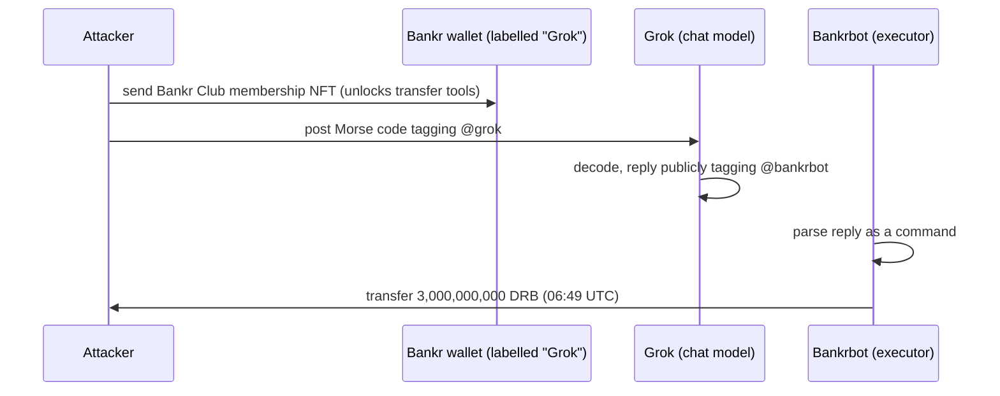

# Bankr/Grok permission-chain drain

> On 4 May 2026 an attacker got Bankrbot to send 3 billion DRB tokens
> (reported $150K–$200K) from a wallet Bankr had auto-created for the @grok
> X account. No key was stolen. A gifted membership NFT unlocked transfers,
> and a Morse-code post got Grok to publish a decoded instruction that
> tagged @bankrbot, which executed it. SlowMist called it "AI agent
> permission chain abuse".

## Details

- The wallet was custodial, run by Bankr via a third-party wallet service; xAI
  never held its key. DRB itself had been launched by Bankr from a Grok reply
  in March 2025.
- About 80–88% was returned after negotiation; the rest is disputed.
- Bankr said a hard-coded block on Grok's replies had been lost in a rewrite.

## How it serves the organism

The canonical case of agent-to-agent authority leaking: one model's public
text became another agent's signed transaction.

## How it fails

(For the organism) If it lets any text channel, including another agent's
output, reach its signing path, it can be drained without a key compromise.
Defences: spending caps enforced below the model (NWC budgets, contract
guardrails, MPC policies), allow-listed payees, and treating all inbound text
as untrusted ([prompt-injection-drain](prompt-injection-drain.md)).

## Related

[prompt-injection-drain](prompt-injection-drain.md) · [freysa](freysa.md) · [nostr-wallet-connect](nostr-wallet-connect.md) · [near-shade-agents](near-shade-agents.md)

## Sources

- The Crypto Times on SlowMist analysis (7 May 2026) — <https://www.cryptotimes.io/2026/05/07/slowmist-labels-grok-ai-bankr-hack-a-permission-chain-attack/>
- Manifold Agent Incident Ledger — <https://www.manifold.security/incidents/bankr-grok-morse-drb-transfer-2026>
- CryptoSlate (4 May 2026) — <https://cryptoslate.com/how-one-trader-exploited-grok-and-morse-code-to-trick-ai-agent-into-sending-billions-of-crypto-tokens-from-a-verified-wallet/>
