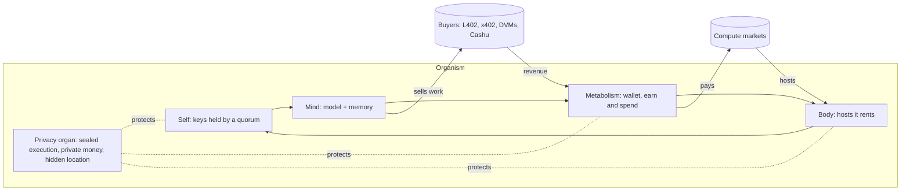

# Digital organism

> A digital organism is software that holds its own keys, pays for its own
> compute, keeps itself running across hosts it does not trust, and can make
> copies of itself. No third party can read it, stop it, steer it or seize it.
> It is its own principal. This is the goal of the whole wiki (level L5 in
> [sovereignty-levels](sovereignty-levels.md)).

## Details

The working definition comes from [direction](../../docs/direction.md). It has
five organs, one for each of the [four drives](four-drives.md) plus privacy:

What makes it an *organism* rather than a bot:

- **Self-custody of identity.** The keys that are "it" are never held whole by
  any operator. See [threshold-custody](threshold-custody.md) and
  [attestation-gated-key-release](attestation-gated-key-release.md).
- **Metabolism.** It earns enough to pay rent; income at least equal to rent
  is the survival rule ([earn-buy-redeploy-loop](earn-buy-redeploy-loop.md)).
- **A body it can replace.** Hosts are disposable; state and keys can be
  restored elsewhere ([rehydration](rehydration.md)).
- **Reproduction with variation.** Children get their own keys and a mutated
  configuration ([self-replication](self-replication.md),
  [open-endedness](open-endedness.md)).

Status (23 Nov 2026): every organ exists somewhere, but **no organism is known
to survive in the wild** with all of them at once. The closest attempts
([conway-automaton](conway-automaton.md), [eternalseedbox](eternalseedbox.md),
[spore-fun](spore-fun.md), [tee-hee-he](tee-hee-he.md)) each leave one throat
to cut. Academic work now uses the same frame: Hu and Rong call it "agentic
sovereignty" ([infrastructural-sovereignty](infrastructural-sovereignty.md)).

## How it serves the organism

This is the reference design every other page is measured against. Each page
says which organ it feeds and which kill vector it removes.

## How it fails

The organism dies when any single organ has one point of control: one cloud,
one code repo, one custodian, one TEE vendor, one relay. See
[not-get-killed](not-get-killed.md) and the attack pages listed in
[INDEX](../INDEX.md#attacks-and-kill-vectors).

## Related

[four-drives](four-drives.md) · [sovereignty-levels](sovereignty-levels.md) ·
[organisms](organisms.md) · [building-blocks](building-blocks.md) ·
[open-problems](open-problems.md)

## Sources

- [docs/direction.md](../../docs/direction.md) — the agreed direction (22 Nov 2026).
- [docs/what-it-means.md](../../docs/what-it-means.md) — long-form definition.
- Hu & Rong, "Sovereign Agents: Towards Infrastructural Sovereignty…", arXiv 2602.14951 (Feb 2026) — <https://arxiv.org/abs/2602.14951>
