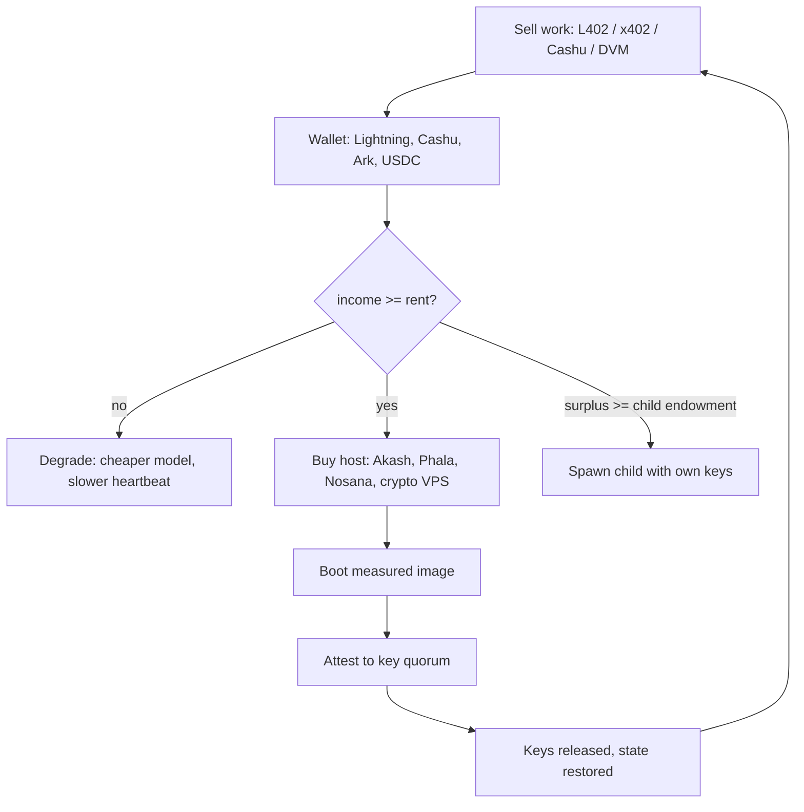

# The earn → buy → redeploy loop

> The organism's metabolism: earn money without an account, buy compute
> without permission, start a new body there and restore its keys. Every piece
> exists. **Nobody has published the closed loop running without a human**
> (as of 23 Nov 2026).

## Details

Rules from the record:

- **Survival:** income ≥ rent. A $0.06/hour CVM is about $43/month before
  inference ([economy](economy.md)).
- **Reproduction:** surplus ≥ the child's endowment. EternalSeedBox passes 40%
  of reserves to each child ([eternalseedbox](eternalseedbox.md)).
- Without income, €10,000 of genesis capital grew EternalSeedBox to 33 nodes
  and ran out on day 153 (simulation).

Measured demand is thin. x402 sell-side across tracked venues was about
$19K/week (9–16 Nov 2026); the L402 proxy measured by Alby saw about $40 in
total since July; DVMs settle a median of 21 sats ([economy](economy.md),
[op-non-token-revenue](op-non-token-revenue.md)).

## How it serves the organism

It is the only path from "funded by a creator" to "self-funding". Without it
the organism has a fixed lifespan set by its genesis capital.

## How it fails

- Buy side: anonymous, permissionless confidential compute is shrinking
  ([sporestack](sporestack.md) closed to new tokens 7 Nov 2026;
  [op-anonymous-confidential-compute](op-anonymous-confidential-compute.md)).
- Earn side: revenue other than token speculation is tiny.
- Redeploy side: keys can only follow the organism if a quorum releases them to
  attested code ([attestation-gated-key-release](attestation-gated-key-release.md)).
- Pay side: wallets that act on text can be talked into paying an attacker
  ([prompt-injection-drain](prompt-injection-drain.md)).

## Related

[compute](compute.md) · [economy](economy.md) · [survival-tiers](survival-tiers.md) · [conway-automaton](conway-automaton.md) · [mesh-llm](mesh-llm.md)

## Sources

- [docs/state-of-the-art.md §Drive 4](../../docs/state-of-the-art.md) (22 Nov 2026).
- EternalSeedBox paper, arXiv 2609.05431 (Sep 2026) — <https://arxiv.org/abs/2609.05431>
- settled.tools weekly reports (9–16 Nov 2026) — <https://settled.tools/reports>
