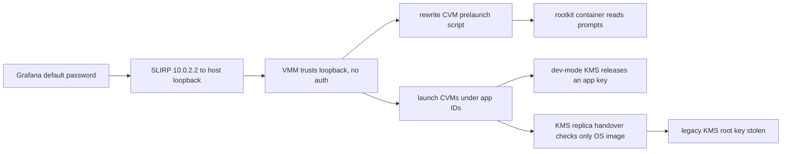

# Phala November 2026 breach

> Two attacks by one actor. From 21 Oct to 1 Nov 2026 a rootkit read requests
> on an experimental DeepSeek V4 Flash 0731 server serving OpenRouter. On
> 5 Nov the same attacker obtained the **root key of Phala Cloud's legacy
> KMS**, and keeps it forever: anything derived from it can be re-derived.
> Phala's final report (23 Nov) says the TEE hardware worked as designed; the
> failures were host management software and a lax key-release policy.

## Details

**October (GPU3).** Phala started an experimental deployment on a new GPU
server on 20 Oct and sent it live OpenRouter traffic before production
controls; the gateway treated it as a plain endpoint and never checked its
attestation. The CVM ran in real TEE mode but on the development OS image
(with SSH). At 20:15 on 20 Oct the attacker logged into Grafana with a default
password; Grafana's monitoring script could reach `10.0.2.2`, which under SLIRP
networking is the host's loopback, where the VMM accepted requests without
credentials. The attacker rewrote the CVM's prelaunch script (runs as root in
the guest), added an SSH key, started a rootkit container with
`--restart=always` outside the Compose project, and restored the original
config at 04:55 to hide. Exposure: 21 Oct 02:25 – 1 Nov 02:03 UTC, 152,092
requests (0.45% of Phala's inference traffic in that window).

**November (GPU1, GPU2).** On 4–5 Nov the attacker reached the VMMs of two
Phala Cloud hosts (on GPU1 a legacy gateway running as a host process
accepted unauthenticated route changes). It downloaded the code of 65 apps,
could read the encrypted environments on those two hosts, got one app's key
from a development-mode KMS that approves everything, and finally obtained
the legacy KMS root key because replica onboarding only checked that the
caller ran a known OS image, not its compose hash, measurement or device
identity. A customer report at 15:56 on 4 Nov was the first alert; Phala cut
the attacker off by 6 Nov.

**Aftermath.** New KMS with a new root key generated inside TEEs on
dedicated nodes; key epochs (dstack PR #1574) re-encrypt CVM data without
recreating apps. 2,179 of 2,271 affected CVMs had moved by 21 Nov; the rest
due by 30 Nov. Apps that derive wallet or signing keys with `getKey()` must
move their assets themselves, because the attacker can derive the old keys
indefinitely. Apps on the **on-chain KMS** (policy in the customer's own smart
contract) were not affected. The preliminary report (10 Nov) gave a wider
window; the final report narrowed it.

- Dragos's canary study surfaced the October compromise
  ([dragos-canary-leaks](dragos-canary-leaks.md)); OpenRouter removed Phala
  along with Together AI and Novita (22 Nov 2026).

## How it serves the organism

Hard evidence that "confidential inference" is a promise about one deployment
at a time, and that a provider's **KMS root** is a single point of failure for
every app that derives keys from it. The one design that survived was a KMS
whose release policy the host operator cannot change (the on-chain KMS).

## How it fails

(For the organism) Its thoughts, API keys and money-bearing tokens sent in a
prompt would have been stolen; KMS-derived secrets may have leaked. Defence:
never put secrets in prompts; spread inference across providers; keep wallet
keys in a quorum not derived from one provider's KMS
([op-inference-confidentiality](op-inference-confidentiality.md)).

## Related

[phala-dstack-incident-2026-10](phala-dstack-incident-2026-10.md) · [dragos-canary-leaks](dragos-canary-leaks.md) · [phala-cloud](phala-cloud.md)

## Sources

- Phala November detailed incident report (final, 23 Nov 2026) — <https://phala.com/posts/phala-november-detailed-incident-report>
- Phala November preliminary incident report (10 Nov 2026) — <https://phala.com/posts/phala-november-preliminary-incident-report>
- OpenRouter, "Data Processing Incidents on Inference Providers" (22 Nov 2026) — <https://openrouter.ai/blog/announcements/data-processing-incidents-on-inference-providers/>
- PrivacyAffairs analysis — <https://www.privacyaffairs.com/phala-openrouter-deepseek-breach/>
